<p align="center">
  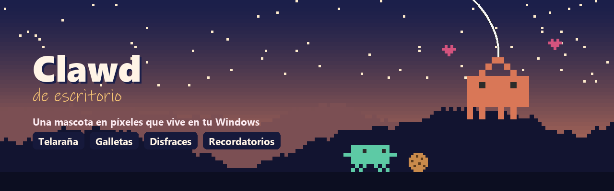
</p>

<p align="center">
  <a href="https://github.com/lilgolda/clawd-escritorio/releases/latest"></a>
</p>

<p align="center">
  
  
  
  
  <a href="LICENSE"></a>
</p>

<p align="center">
  <a href="#qué-sabe-hacer">Qué sabe hacer</a> ·
  <a href="#descargar">Descargar</a> ·
  <a href="#cómo-se-usa">Cómo se usa</a> ·
  <a href="#privacidad">Privacidad</a> ·
  <a href="#cómo-está-hecho">Cómo está hecho</a> ·
  <a href="#contribuir">Contribuir</a> ·
  <a href="#in-english">English</a>
</p>

---

Clawd pasea por encima de tu barra de tareas, se cuelga de tu ratón con un hilo de telaraña, te trae postales que pinta él, saca su laptop cuando escribes y te recuerda que descanses la vista.

<p align="center">
  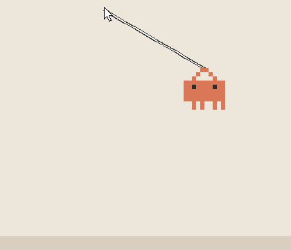
</p>

> [!NOTE]
> Es un proyecto de fans, hecho por gusto y sin relación oficial con Anthropic. Clawd es la mascota de Claude Code; aquí solo le hemos dado una casa en el escritorio.

## Qué sabe hacer

<table>
  <tr>
    <td align="center">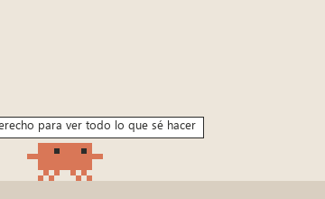<br>Pasea, respira y parpadea</td>
    <td align="center">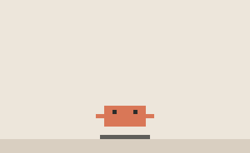<br>Cuando escribes, saca su laptop y teclea contigo</td>
  </tr>
  <tr>
    <td align="center">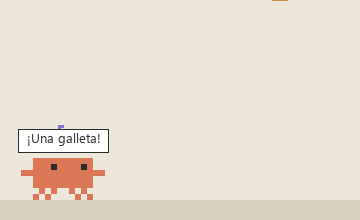<br>Dale una galleta: corre a por ella y se la come</td>
    <td align="center">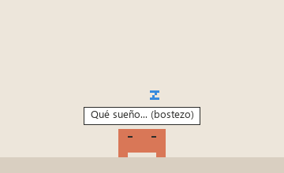<br>Si no le haces caso, se aburre y se duerme</td>
  </tr>
  <tr>
    <td align="center">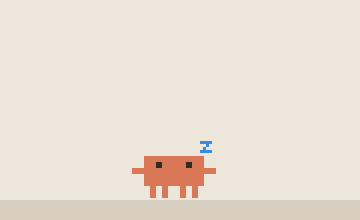<br>Baila cuando suena música en el ordenador</td>
    <td align="center">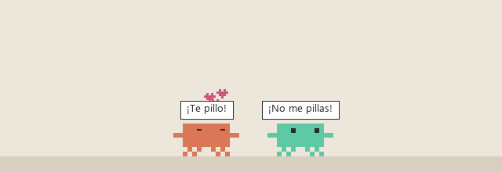<br>Invita a su amigo Bit y juegan al pilla-pilla</td>
  </tr>
</table>

Y además:

- **Se cuelga de tu ratón** con un hilo de telaraña que tiene física de verdad: se balancea suave como Spider-Man y, si das un tirón brusco, el hilo hace un latigazo. Al soltarse sale volando con el impulso.
- **Arrástralo y lánzalo**: rebota en las paredes, el techo y el suelo. Si lo zarandeas mucho, se marea.
- **Trepa por la pared** y se cuelga del borde de arriba de la pantalla.
- **Se sube encima de tus ventanas** y se cae si las mueves.
- **Caza el ratón** como un gato persigue un puntero láser.
- **Te trae cosas** de vez en cuando: mensajes bonitos, postales en píxeles que pinta él (cada una es distinta) o fotos de internet.
- **Mimos**: pasa el ratón por encima sin hacer clic y le salen corazones.
- **Mira el tiempo de tu ciudad** y saca el paraguas si llueve.
- **Se esconde solo** si juegas o ves algo a pantalla completa.

### Disfraces

<p align="center">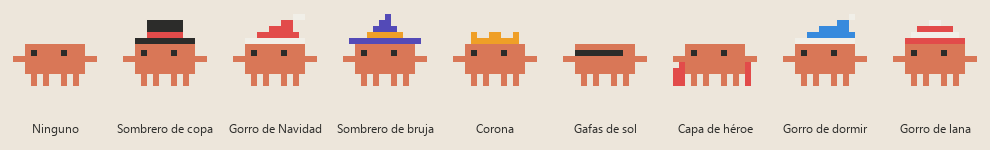</p>

En modo **Automático** se viste según el día: sombrero de bruja en octubre, gorro de Navidad en diciembre, gorro de dormir por la noche, gorro de lana si nieva y gafas de sol si hace calor.

### Recordatorios y pausas, escritos a mano

Pídele que te recuerde algo y, cuando llegue la hora, aparece corriendo con un cartel. Cada hora de uso te trae otro para que descanses.

<p align="center">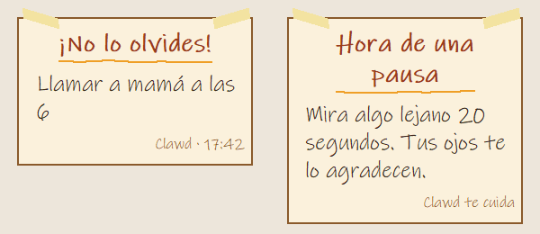</p>

## Descargar

1. Ve a la [**última versión**](https://github.com/lilgolda/clawd-escritorio/releases/latest) y descarga `Clawd.exe`.
2. Ábrelo con doble clic. No hace falta instalar nada.

> [!TIP]
> La primera vez, Windows puede mostrar un aviso de "Windows protegió su PC", porque el programa no está firmado (firmarlo cuesta dinero). Pulsa **Más información → Ejecutar de todas formas**. Si prefieres no fiarte de un `.exe`, puedes [ejecutarlo desde el código](#ejecutarlo-desde-el-código): es exactamente lo mismo.

Tus ajustes y recordatorios se guardan en `clawd_datos.json`, al lado del `.exe`.

## Cómo se usa

| Acción | Qué hace |
|---|---|
| Clic | Salta |
| Arrastrar | Te lo llevas colgando de un hilo; si lo sueltas en marcha, sale volando |
| Pasar el ratón por encima | Mimos |
| Clic derecho | El menú con todo lo demás: travesuras, galletas, disfraces, recordatorios, ajustes... |
| Icono junto al reloj | Clic para esconderlo o mostrarlo; clic derecho para el menú |

### Ajustes

<p align="center">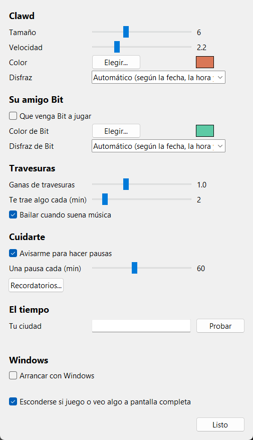</p>

Tamaño, velocidad, colores, disfraces, cuántas travesuras hace, cada cuánto te trae cosas, las pausas, tu ciudad y si arranca con Windows.

## Privacidad

- **Teclado:** Clawd solo mira *si* pulsas una tecla, para sacar su laptop. No sabe cuál pulsas, no guarda nada y no lo envía a ningún sitio.
- **Sonido:** solo lee el nivel de volumen que sale por los altavoces, para saber si suena música. No graba nada.
- **Internet:** solo se conecta para descargar las fotos que te trae (de [Lorem Picsum](https://picsum.photos)) y, si escribes tu ciudad, para mirar el tiempo (en [Open-Meteo](https://open-meteo.com)). A Open-Meteo solo se le envía el nombre de la ciudad.
- Todo lo demás se queda en tu ordenador, en `clawd_datos.json`.

## Ejecutarlo desde el código

Necesitas Windows y [Python](https://www.python.org/downloads/) 3.10 o más nuevo (está probado con 3.14).

```bash
git clone https://github.com/lilgolda/clawd-escritorio.git
cd clawd-escritorio
py -m pip install -r requirements.txt
pyw clawd_escritorio.py
```

`pyw` lo arranca sin la ventana negra de la consola. Si estás tocando el código, usa `py` para ver los errores.

Pillow es opcional: sin Pillow funciona igual, pero te trae postales en vez de fotos y no tiene icono propio junto al reloj.

## Crear el .exe

```bash
py -m pip install pyinstaller pillow
```

```bash
construir_exe.bat
```

Tarda un minuto más o menos. Al terminar, en la carpeta del proyecto aparecen dos carpetas nuevas:

| Carpeta | Qué es |
|---|---|
| `dist\` | **Aquí está `Clawd.exe`**, listo para usar |
| `build\` | Archivos temporales de la construcción. Puedes borrarla |

`Clawd.exe` funciona solo, sin el resto de archivos del proyecto, así que puedes moverlo a donde quieras (por ejemplo a `Documentos\Clawd`). Tus ajustes se guardan en un `clawd_datos.json` que aparece al lado del `.exe`. Si lo mueves, mueve ese archivo con él.

Las dos carpetas están en el `.gitignore`, así que no se suben a GitHub. Para compartir el `.exe`, súbelo en una *Release*.

## Cómo está hecho

Todo es Python con Tkinter (que ya viene con Python) y `ctypes` para hablar con Windows. No necesita nada más.

| Archivo | Qué hay dentro |
|---|---|
| `clawd_escritorio.py` | El "mundo": arranca todo, el bucle de 30 fotogramas por segundo, el menú, la música, los avisos y la capa donde se dibujan los hilos y las galletas |
| `clawd.py` | Clawd: sus estados (caminar, dormir, colgarse...), cómo decide qué hacer y cómo se dibuja |
| `dibujos.py` | Los dibujos en píxeles. Cada letra es un píxel: cámbialas y cambias a Clawd |
| `cosas.py` | Lo que te trae (mensajes, postales, fotos, carteles), el globo de texto y las galletas |
| `fisica.py` | El hilo de telaraña, con física Verlet |
| `ajustes.py` | La ventana de ajustes y la de recordatorios |
| `tiempo.py` | El tiempo de tu ciudad |
| `windows.py` | Lo que habla directamente con Windows: ventanas, sonido, pantalla completa, icono junto al reloj y arranque |
| `herramientas/generar_imagenes.py` | Genera las animaciones de este README a partir del dibujo real de Clawd |

Algunas ideas por si quieres trastear:

- **Clawd funciona con estados.** Cada uno tiene su función `estado_<nombre>()` en `clawd.py`, que se llama 30 veces por segundo. Para enseñarle algo nuevo, crea un estado y llámalo desde `decidir()`.
- **El hilo de telaraña** son 11 puntitos que recuerdan dónde estaban en el fotograma anterior; esa diferencia es su velocidad. Luego se corrigen para que cada trozo mantenga su largo. Como los del medio tardan en enterarse de que moviste el ratón, un tirón recorre el hilo como una ola: el latigazo.
- **Para que vaya fluido**, Clawd no redibuja si nada cambió, junta los píxeles seguidos del mismo color en un solo rectángulo y le pide a Windows un reloj preciso. Sin eso, las esperas de 33 ms duran 47 y la animación va a saltos.

## Contribuir

¡Las ideas y mejoras son bienvenidas! Puedes [contar una idea](https://github.com/lilgolda/clawd-escritorio/issues/new?template=idea.yml), [avisar de un error](https://github.com/lilgolda/clawd-escritorio/issues/new?template=error.yml) o mandar un *pull request*. En [CONTRIBUIR.md](CONTRIBUIR.md) está explicado paso a paso, también si es tu primera vez.

Lo nuevo de cada versión está en [NOVEDADES.md](NOVEDADES.md).

## Créditos

- Datos del tiempo: [Open-Meteo.com](https://open-meteo.com) (licencia CC BY 4.0).
- Fotos: [Lorem Picsum](https://picsum.photos), que usa fotos de [Unsplash](https://unsplash.com).
- Letra de los carteles: *Ink Free*, que viene con Windows.

## Agradecimientos

Este proyecto lo hice mientras aprendía a programar puede que haya errores, con la ayuda de [Claude Code](https://github.com/anthropics/claude-code) puede hacerlo mas vistoso, el asistente de programación de Anthropic. Gracias, Claude, por la paciencia y por dejar que tu mascota viva en mi escritorio 🦀

Agradezco tambien a quienes me enseñaron las bases de esto, Gracias.

## Licencia

El código es libre bajo la [licencia MIT](LICENSE). El personaje de Clawd pertenece a Anthropic.

## In English

**Clawd de escritorio** is a pixel-art desktop pet for Windows. Clawd walks along your taskbar, swings from your mouse cursor on a physics-based spider-web thread, brings you postcards it paints itself, pulls out a tiny laptop when you type, dances to your music and reminds you to take breaks with handwritten notes. It also has costumes, cookies, a friend called Bit, weather awareness and a tray icon.

[Download `Clawd.exe`](https://github.com/lilgolda/clawd-escritorio/releases/latest) and double-click it, or run it from source with `pyw clawd_escritorio.py` (Python 3.10+, optional `pip install pillow`). The interface is in Spanish. This is an unofficial fan project, not affiliated with Anthropic.

---

<p align="center">Hecho con cariño, píxel a píxel 🦀</p>
